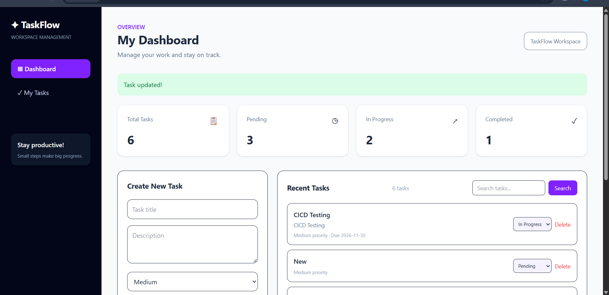

# TaskFlow – Laravel CI/CD Automation on AWS EKS



TaskFlow is a Laravel-based task management application deployed on Amazon EKS using Docker, Jenkins, Amazon ECR, and Kubernetes.

This project demonstrates an end-to-end CI/CD workflow, from application code changes to automated container image deployment on Kubernetes.

## Features

- Create, view, update, and delete tasks (CRUD)
- Search tasks by title
- Task status management:
  - Pending
  - In Progress
  - Completed
- Task priority management:
  - Low
  - Medium
  - High
- Due date management
- Dashboard with task statistics

## Technology Stack

| Category | Technologies |
|---|---|
| Backend | PHP, Laravel |
| Frontend | Blade, Tailwind CSS |
| Database | MySQL 8.0 |
| Containerization | Docker |
| CI/CD | Jenkins |
| Container Registry | Amazon ECR |
| Orchestration | Amazon EKS, Kubernetes |
| Cloud | AWS |
| Version Control | Git, GitHub |

## Architecture

```text
        Developer
            |
            v
        GitHub
            |
            v
         Jenkins
            |
      +-----+------+
      |            |
      v            v
 Docker Build   AWS ECR
                   |
                   v
              Docker Image
                   |
                   v
              Amazon EKS
                   |
             +-----+------+
             |            |
             v            v
       TaskFlow App     MySQL
             |
             v
       LoadBalancer
             |
             v
        Web Browser
```

## CI/CD Pipeline

The Jenkins pipeline performs the following stages:

1. **Checkout:** Retrieves application source code from GitHub.
2. **Verify AWS:** Checks AWS identity using STS.
3. **Build Docker Image:** Builds the Laravel application image.
4. **ECR Login:** Authenticates Docker with Amazon ECR.
5. **Push to ECR:** Pushes versioned and latest image tags to ECR.
6. **Deploy to EKS:** Updates the Kubernetes Deployment with the new image using `kubectl set image`.
7. **Rollout Verification:** Waits for the Kubernetes Deployment rollout to complete.

The pipeline is manually triggered using Jenkins Build Now.

## AWS Infrastructure

- AWS Region: `eu-north-1`
- Container Registry: Amazon ECR
- Kubernetes Cluster: Amazon EKS
- Application Deployment: Kubernetes Deployment
- Database Deployment: MySQL Deployment
- Application Exposure: AWS LoadBalancer Service
- Database Networking: Kubernetes ClusterIP Service
- Application configuration and database credentials: Kubernetes Secrets
- Jenkins AWS access: IAM EC2 instance role

## Project Structure

```text
taskflow/
│
├── app/
│   └── Http/Controllers/
│       └── TaskController.php
│
├── resources/
│   └── views/
│       └── tasks/
│           └── index.blade.php
│
├── routes/
│   └── web.php
│
├── database/
│
├── k8s/
│   ├── taskflow.yaml
│   └── mysql.yaml
│
├── Dockerfile
├── .dockerignore
├── Jenkinsfile
└── README.md
```

## Local Setup

### Prerequisites

- PHP 8.2+
- Composer
- Node.js and npm
- MySQL
- Docker

### Installation

Clone the repository:

```bash
git clone https://github.com/chitra2702/taskflow-laravel-devops.git
cd taskflow-laravel-devops
```

Install PHP dependencies:

```bash
composer install
```

Install frontend dependencies:

```bash
npm install
npm run build
```

Configure your local `.env` file with your database credentials.

Generate the Laravel application key:

```bash
php artisan key:generate
```

Run database migrations:

```bash
php artisan migrate
```

Start the application:

```bash
php artisan serve
```

## Docker Build

Build the Docker image:

```bash
docker build -t taskflow:v1 .
```

Run the container:

```bash
docker run -d -p 8080:80 --name taskflow taskflow:v1
```

Configure the required Laravel and database environment variables before running the application.

## Kubernetes Deployment

The Kubernetes manifests are available in the `k8s/` directory.

- `taskflow.yaml`: Laravel Deployment and LoadBalancer Service.
- `mysql.yaml`: MySQL Deployment and ClusterIP Service.

The cluster requires the following Kubernetes Secrets to be created before deployment:

- `taskflow-app-secret`
- `taskflow-db-secret`

Apply the manifests:

```bash
kubectl apply -f k8s/mysql.yaml
kubectl apply -f k8s/taskflow.yaml
```

Verify deployments and services:

```bash
kubectl get pods
kubectl get deployments
kubectl get services
```

## Validation

The deployment was tested by:

- Verifying successful Jenkins pipeline execution.
- Confirming Docker image upload to Amazon ECR.
- Verifying the updated image on the EKS Deployment.
- Checking Kubernetes rollout status.
- Accessing the application through its LoadBalancer URL.
- Testing CRUD operations and the newly added task search feature on the deployed application.

## Important Notes and Limitations

- MySQL currently uses Kubernetes `emptyDir` storage. Database data is not persistent if the MySQL Pod is recreated.
- Database persistence using a suitable persistent volume is a future improvement.
- Jenkins pipeline execution is manually triggered; GitHub webhook integration is not configured.
- Kubernetes Secrets are created separately and are not committed to this repository.
- AWS resources may incur charges. Review and clean up resources when the project is not in use.

## Future Improvements

- Configure GitHub webhook integration with Jenkins.
- Implement persistent database storage using EBS CSI.
- Add automated application tests to the CI pipeline.
- Add application health checks and monitoring.
- Implement improved deployment and rollback strategies.

## Author

**Chitra Manam**

GitHub: https://github.com/chitra2702

LinkedIn: https://linkedin.com/in/chitra-manam
